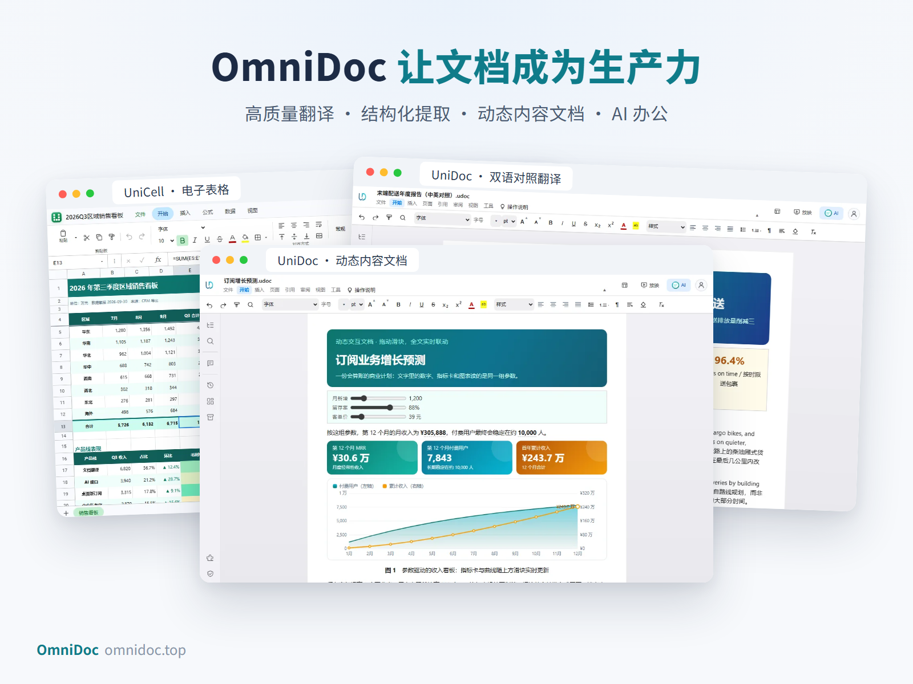
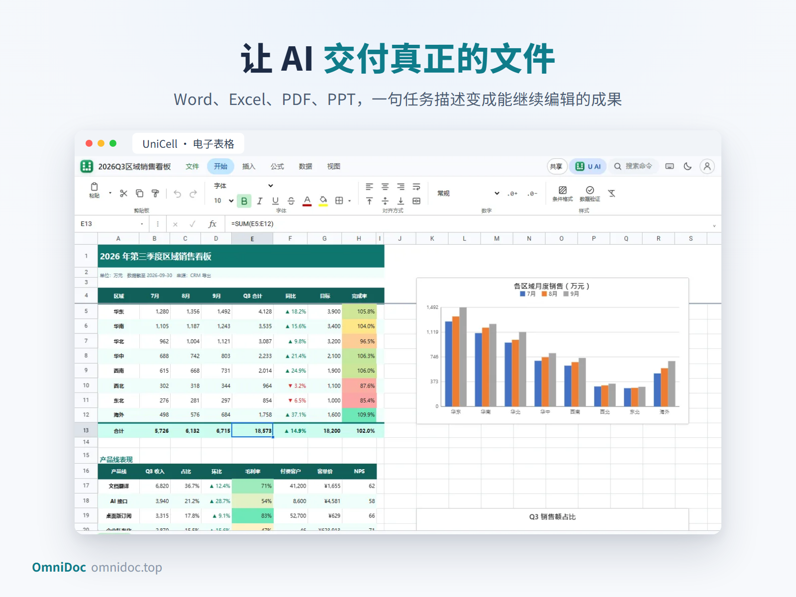
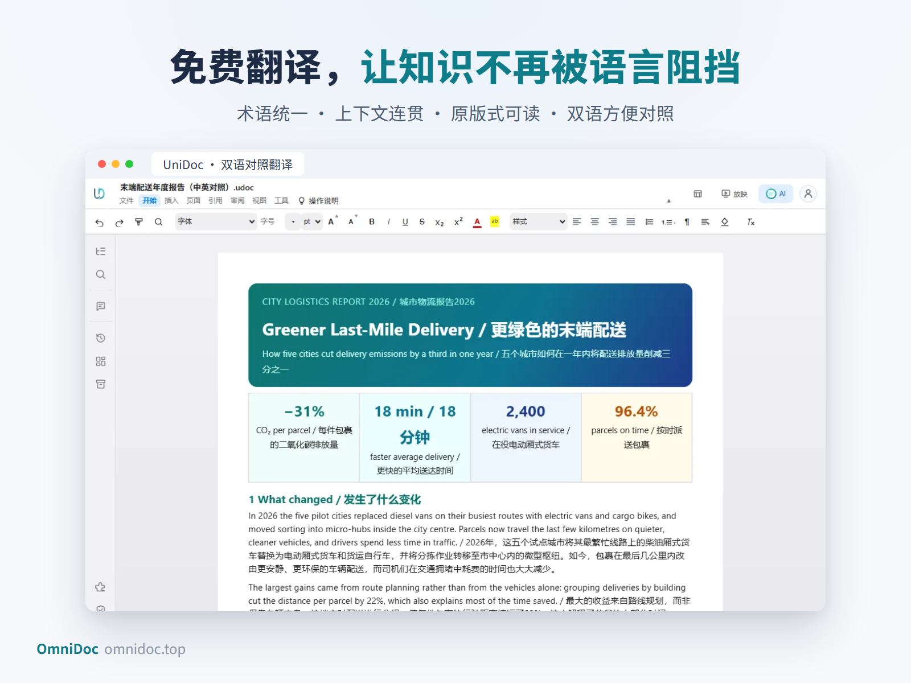

# OmniDoc：超强的办公能力 + 免费文档翻译，让文档成为生产力

**OmniDoc，是把高质量翻译、文档结构化提取、动态内容文档和 AI 办公整合在一起的新一代文档生产力平台。** 它让学生读懂世界，让研究者更快获取知识，让职场人把时间花在判断和创造上，也让 AI 从回答问题走向完成工作。

官网：**https://omnidoc.top/** · 下载页：https://download.omnidoc.top/ · 开发者文档：https://docs.omnidoc.top/

## 品牌主张

- **免费翻译，让知识不再被语言阻挡。**
- **冲击最强翻译效果，让专业内容真正被读懂。**
- **打造最强的文档结构化提取能力，让文件变成可用的数据。**
- **世界首款动态内容文档，让文档从静态页面变成可探索的知识空间。**
- **学生完全免费，让真正需要工具的人先拥有工具。**
- **做中国新生的金山软件，做面向全球的下一代办公力量。**

## 超强的办公能力：让 AI 交付真正的文件

办公工作最后往往要落在一份文件上。OmniDoc 把文档能力交给 AI，也把实际交付放回工作流的中心：**从一句任务描述，到一份能打开、能检查、能编辑、能继续使用的文件。**

- **文档写作，从生成文字走向完成成稿**。研究报告、课程论文、项目方案、产品文档、合同说明、会议纪要，都可以成为它的工作对象。
- **表格处理，让数字变成结论**。多张工作表、复杂公式、合并单元格、条件格式、图表和透视汇总，读取、整理、计算、生成图表，再把结果放回能继续使用的工作簿。
- **PDF 处理，让阅读和编辑更接近实际需求**。点进段落直接改字，打字时就显示保存后的最终排版；页面整理、批注、涂黑、电子签名、表单、识别文字、文件比较，导出 Word、Excel、PowerPoint。
- **演示文稿，让想法更快成为能够讲清楚的表达**。围绕内容组织幻灯片，处理表格、图表、备注和演示输出。
- **世界首款动态内容文档**。一张图表可以响应参数变化，一份教学材料可以让学生自己调整变量，发布成网页后仍然可以互动。
- **MCP，让 OmniDoc 成为 AI 的办公能力层**。Claude、Codex、Cursor 等 AI 助手直接读取、创建、编辑、检查和导出 Word、Excel、PowerPoint、PDF；打开着的文档会跟着 AI 的修改原地更新。

**当 AI 拥有可靠的文档工具，它才更接近一位能够交付成果的助手。**

## 免费文档翻译：让知识以原来的样子抵达你

一篇论文，不应该因为语言而被搁置。OmniDoc 把免费翻译放在重要的位置，是因为翻译首先是一种获取知识的能力。**语言应该成为连接世界的桥梁，知识应该抵达愿意学习的人。**

- **整篇翻译**：上传 PDF，选择目标语言，排队完成后整份下载，不用再一段段复制粘贴。
- **双语对照和纯译文一次给两个**：PDF 和 LaTeX 翻译完成后同时生成，双语对照适合精读、查证，纯译文适合直接阅读和转发。
- **原版式可读**：标题层级、段落、表格和图片位置，翻译时尽量按原文件保留。
- **多格式**：PDF、Word、PowerPoint、Excel、CSV、EPUB、Markdown、TXT、网页、字幕、图片，以及 LaTeX 的 .tex 和源码包。
- **专业内容，值得专业的翻译**：术语表、上下文翻译、翻译风格和深度思考等选项，让同一个术语在摘要、正文和图表里保持一致。
- **规则写在明面上**：不扣积分；单个文件最多 200 页；每人同时处理 2 个文件，其余自动排队；每天有免费名额，用完后已提交的照常完成，第二天可以再来；结果只有你自己看得到。

在线入口：https://omnidoc.top/guides/free-pdf-translator/ （浏览器打开即可，登录后进入「免费翻译」）。AI 翻译适合快速读懂和出初稿，合同条款、投稿论文里的数字、术语和引用，请对照原文核对。

## 下载（OmniDoc 1.09 build 131）

| 系统 | 安装包 | 大小 | SHA-256 |
| --- | --- | --- | --- |
| Windows 10 / 11（64 位） | `OmniDoc-1.09-b131-Windows-x64-Setup.exe` | 312,273,512 字节 | `b1e2b4e15ae573aed622d5dcdf2e7a42ef1e5c7002e2ec6b24c3769b632b5a53` |
| Linux x86_64（Ubuntu、Debian 等） | `OmniDoc-1.09-b131-Linux-x86_64.deb` | 390,399,672 字节 | `2f037efec0d978d61152c0078b3f95d740cc767085ac634eb6d3b5adfb1f7cde` |
| macOS 12 及以上（Intel） | `OmniDoc-1.09-b131-macOS-x64.dmg` | 362,695,549 字节 | `ee85444969c30e79cc7b82608184926d39af8582d4e7c7f1537e10b036c7b888` |

三个安装包都在 [Releases](https://github.com/CBIhalsen/omnidoc/releases) 页面下载，上表列出每个安装包的 SHA-256，下载后可以核对。也可以从官网下载页 https://download.omnidoc.top/ 获取。桌面版可以免费下载和使用；编辑和格式转换离线免费，翻译、发布为网址等在线功能需要登录 OmniDoc 账号。

## 许可

OmniDoc 是专有软件，不是开源软件。本仓库只发布安装包，源代码不公开。你可以免费下载、安装和使用；复制、再分发、反向工程等限制见 [LICENSE](LICENSE)。在线功能（账号、翻译、AI、分享、签署）另受 https://omnidoc.top/terms 和 https://omnidoc.top/privacy 约束。

**OmniDoc，让文档成为生产力。让知识自由流动，让工作更快完成。** 访问 [omnidoc.top](https://omnidoc.top)，开启你的下一代文档体验。

注：“最强”“世界首款”“领先世界”及免费权益等表达为品牌方宣传口径，不作为独立第三方评测结论。

# OmniDoc: a powerful AI office suite with free document translation

**OmniDoc is a next-generation document productivity platform that puts high-quality translation, structured document extraction, dynamic content documents and AI office work in one place.** Free translation lets knowledge cross language barriers; the AI interface (MCP) lets Claude, Codex and Cursor read, create, edit, check and export Word, Excel, PowerPoint and PDF files, and an open document follows the AI's edits in place. Whole-document translation keeps the layout, with side-by-side bilingual or translation-only output, in 90+ languages. Completely free for students.

Download OmniDoc 1.09 build 131 for Windows (.exe), Linux (.deb) and macOS (.dmg) from [Releases](https://github.com/CBIhalsen/omnidoc/releases) or https://download.omnidoc.top/ . Website: https://omnidoc.top/ · Docs: https://docs.omnidoc.top/. OmniDoc is proprietary software, free to download and use; see [LICENSE](LICENSE).

"Strongest", "world's first" and free offers are the brand's promotional wording, not independent third-party evaluations.
